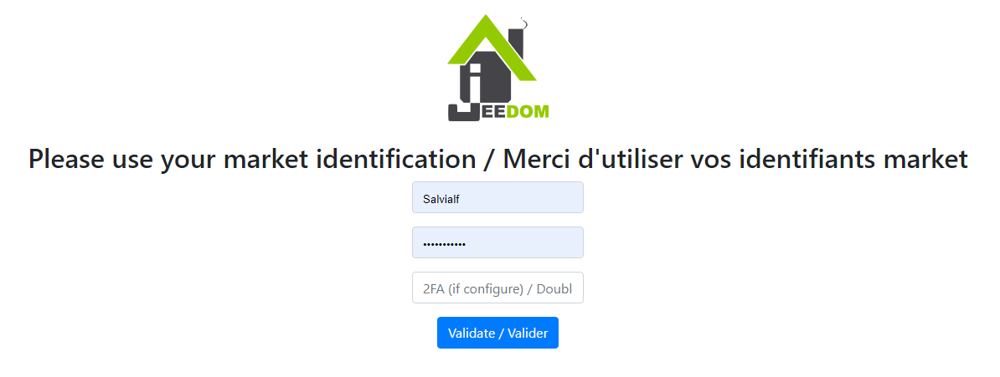
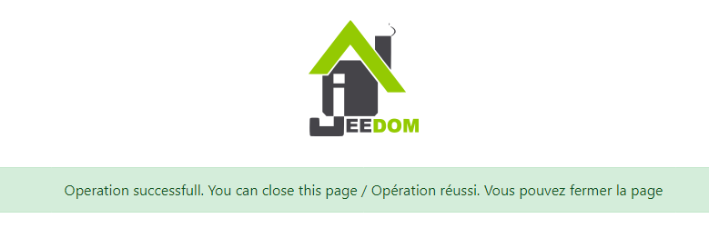
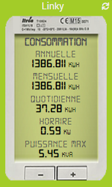
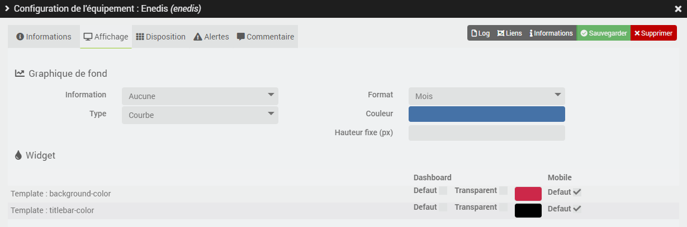

# Plugin Enedis

Plugin permettant la récupération des données de consommation électrique des compteurs communicants *(linky par exemple)* par l'interrogation du [compte-client **Enedis**](https://mon-compte.enedis.fr/auth/XUI/#login/&realm=/enedis&forward=true){:target="\_blank"}.

>**IMPORTANT**
>
>Le plugin a été totalement réécrit en février 2021 pour utiliser **l'api officielle Enedis Data-Connect**. Si vous utilisiez le plugin auparavant, nous vous invitons à créer un nouvel équipement ou à supprimer toutes les commandes d'un équipement antérieur.

Il est possible d'accéder aux données de **consommation**, de **production** ou aux 2 types de mesure directement dans un équipement.

5 données sont remontées pour chaque type de mesure :
- la **consommation horaire** par demi-heure *(en kW)*.
- la **consommation journalière** *(en kWh)*.
- la **consommation mensuelle** *(en kWh)*.
- la **consommation annuelle** *(en kWh)*.
- la **puissance max** *(en kVA)*.

Les données n'étant pas mises à disposition en temps réel par Enedis, le plugin récupère chaque jour celles de la veille. Tant qu'il ne les a pas toutes récupérées, il interroge à nouveau les serveurs Enedis toutes les 30 minutes jusqu'à 19h, puis reprend le lendemain matin.

À chaque récupération, les données jour, mois, année et puissance max sont interrogées depuis le 1er janvier de l'année en cours, et les données horaires sur les 7 derniers jours. Les historiques déjà enregistrés sont réalignés sur les données Enedis : une donnée fournie en retard ou corrigée par Enedis met à jour les valeurs concernées.

# Configuration

Comme tout plugin Jeedom, le plugin **Enedis** doit être activé après l'installation.

## Configuration du plugin

Si ce n'est pas déjà fait, commencez par autoriser le partage des données Enedis avec Jeedom en cliquant sur le bouton **Autoriser l'accès aux serveurs Enedis : j'accède à mon espace client Enedis** depuis la page de configuration du plugin :

Vous êtes alors redirigé vers cette page sur laquelle il faut renseigner **vos identifiants au market Jeedom** puis cliquer sur le bouton **Valider** :

Redirection vers la page de consentement Enedis sur laquelle il faut **cocher la case** et cliquer sur **Valider** :

Une fois le partage des données validé, cette page s'affiche :

>**IMPORTANT**
>
>Si vous ne parvenez pas à accéder à l’une de ces pages, désactiver le bloqueur de publicité du navigateur.

## Configuration des équipements

Pour accéder aux différents équipements **Enedis**, dirigez-vous vers le menu **Plugins → Energie → Enedis**.

>**INFORMATION**
>
>Le bouton **+ Ajouter** permet d'ajouter un nouveau compteur/PDL.

Une fois le partage des données autorisé depuis la page de configuration du plugin, il ne reste plus qu'à renseigner **le numéro d'identification du Point de Livraison** concerné *(PDL)* et le **type de mesure** à récupérer.

Lors de la 1ère sauvegarde d'un équipement actif et configuré, le plugin va automatiquement créer les commandes nécessaires et intégrer les historiques disponibles sur le site Enedis depuis le 1er janvier de l'année en cours. Ce processus est susceptible de durer plusieurs minutes, vous pouvez en suivre l'avancée depuis le menu **Analyse → Logs** *(logs en ``debug``)*.

Si vous n'avez pas activé **l'enregistrement et la collecte de la consommation horaire** sur votre compte Enedis, il faudra cocher la case **Données horaires : Désactiver** pour que les commandes correspondantes ne soient pas créées.

# Ajout de données

Il est possible d'intégrer des historiques à la demande, jusqu'à 3 années en arrière, directement depuis le site Enedis. Pour se faire, il suffit de cliquer sur le bouton bleu **Ajout historiques** depuis l’onglet **Commandes** d’un équipement, dans la colonne **Action** de la commande concernée :

Choisissez ensuite l'année de début *(données jour, mois, année et puissance max)* ou la date de début *(données horaires)* puis cliquez sur **OK** pour initier le processus.

Les données jour, mois, année et puissance max seront intégrées du 1er janvier de l'année choisie jusqu'au 1er janvier de l'année en cours. Les données horaires, quand à elles, seront intégrées jusqu’à 7 jours après la date choisie.

>**INFORMATION**
>
>Ces contraintes de temps sont fixées par Enedis.

# Template de widget

>**INFORMATION**
>
>Le template de widget sera affiché aussi bien sur les versions desktop que mobile.

Le plugin offre la possibilité d'afficher les données de consommation et/ou de production dans un template de widget imitant l'aspect d'un compteur *Linky*. Le clic sur le bouton "**- \| +**" permet de basculer de la consommation à la production pour ceux qui ont accès aux 2 types de mesures. Un voyant permet également de savoir si les données sont à jour ou non *(vert = toutes les données sont à jour, orange = certaines données ne sont pas à jour, rouge = aucune donnée n'est à jour)*.

Le template de widget est activé par défaut. Pour revenir au widget standard de Jeedom, il suffit de décocher la case **Template de widget** dans l'onglet **Informations** de la configuration avancée de l'équipement. Une fois le template de widget activé, rendez-vous à l'onglet **Affichage** de la configuration avancée de l'équipement pour choisir la couleur de fond du widget *(`Template : background-color` - 163, 204, 40 par défaut)* et/ou la couleur du titre *(`Template : titlebar-color` - transparent par défaut)* en fonction de la version d'accès à Jeedom *(bureau ou mobile)*.

>**ASTUCE**
>
>La case "Défaut" permet de conserver les couleurs par défaut de la tuile.

# FAQ

>**J'ai des erreurs `Error on enedis json return` dans les logs pourtant les données sont visibles sur le site Enedis**
>
>Il arrive quelquefois qu'il faille se rendre  directement sur le site Enedis afin de valider les dernières CGU en date pour accéder à nouveau aux données. Il est également parfois nécessaire de remettre en place la liaison Jeedom/Enedis depuis la page de configuration du plugin.
